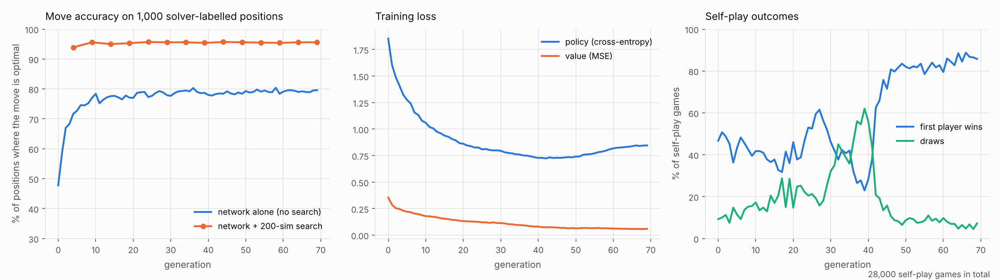
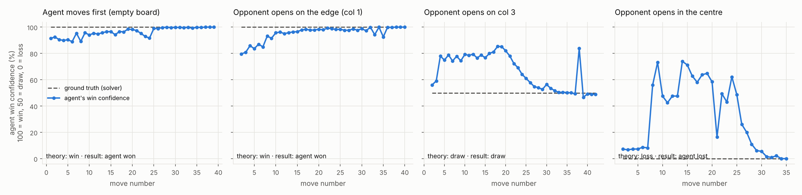
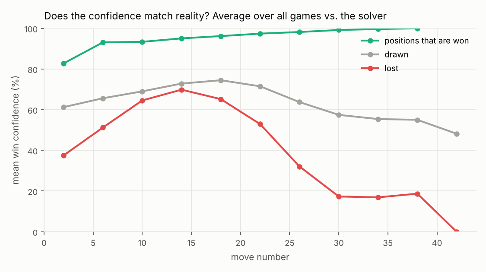

# Connect Zero

An AlphaZero-style Connect Four AI that trains on a normal computer (4 CPU cores, no GPU) and is graded against a perfect solver.

* **Learns from nothing but self-play.** A residual policy/value network guides a batched Monte Carlo tree search (PUCT). Games against itself become its training data.
* **Graded against ground truth.** An exact Connect Four solver, written in C, labels test positions and plays perfect games against the agent.
* **Two engines.**
  * **Zero** is the pure learned player: network plus search, nothing else.
  * **Zero + Proof** adds a proof layer. It uses an opening proof book plus the exact solver whenever a position can be solved within a node budget, and only plays moves that are proven to keep the best result. This is the unbeatable mode.
* **Playable in the browser** (`web/index.html`), with a live win-confidence meter, a move-by-move confidence chart and a per-column view of the AI's search. The network, MCTS and the solver (compiled to WebAssembly) all run inside the page.

## Results

Trained for 70 generations (28,000 self-play games, about 3 hours on 4 CPU cores), then benchmarked at 800 simulations per move.

**Against a perfect solver** (69 games: the agent moves first from the empty board, moves second after each of the 7 first moves, and moves first from all 49 two-move openings; "held" means the agent got the game-theoretic result of its starting position):

| | Zero (pure self-play) | Zero + Proof |
|---|---|---|
| Games that held the theoretical result | 52 / 69 | **69 / 69** |
| Agent moves that were optimal | 1,132 / 1,154 (98.1%) | **1,147 / 1,147 (100%)** |
| Moving first from the empty board (theory: win) | 6 / 6 wins | 6 / 6 wins |
| Moving second after each first move | 8 / 14 | 14 / 14 |
| All 49 two-move openings | 38 / 49 | 49 / 49 |

**Move accuracy on solver-labelled positions** (pure Zero; a move counts as correct if it keeps the game-theoretic result):

| Test set | Network alone | + 50 sims | + 200 sims | + 800 sims |
|---|---|---|---|---|
| 442 positions from strong self-play games | 95.9% | 97.5% | 98.0% | **98.2%** |
| 1,000 positions from random games | 79.6% | 95.4% | 95.6% | **96.4%** |

**Against simple opponents** (2 random opening moves first, so some starts are already theoretically lost; colours alternate):

| Opponent | Zero | Zero + Proof |
|---|---|---|
| Random mover | 50 W / 0 D / 0 L | 50 / 0 / 0 |
| Tactical (wins, blocks, avoids blunders) | 50 / 0 / 0 | 50 / 0 / 0 |
| Classical UCT, 2,000 random rollouts per move | 18 / 0 / 2 | 19 / 1 / 0 |

What this means: the pure learned player wins every game from the empty board against perfect play and picks an optimal move about 98% of the time. It is very strong but not flawless. Its few mistakes come in sharp middlegame positions (plies 6 to 24), as the confidence charts show. Zero + Proof closes that gap, and in every benchmark game it never gave away a result.



The search adds about 16 points over the raw network on random-game positions. The network settles on the centre-column opening by about generation 30. From generation 42 the first player wins about 85% of self-play games. This is consistent with the known theoretical result that the first player wins with perfect play.



The blue line is the agent's own estimate (100 = sure win, 50 = draw, 0 = loss). The dashed line is the truth from the solver. In the centre-opening game the agent is theoretically lost from the start, yet it believes it is fine until about move 20. This is the classic blind spot: Connect Four's long-range "zugzwang" endgames are hard for a small value network to see early.




## Quick start

```bash
pip install -r requirements.txt          # torch, numpy, matplotlib; a C compiler builds the solver on first use

# play in the browser (network + search + solver run client-side)
python serve.py                          # opens http://localhost:8000

# play in the terminal
python -m c4.play                        # you move first
python -m c4.play --ai-first --sims 1600
python -m c4.play --guard                # Zero + Proof mode
python -m c4.play --coach                # the solver grades every move you make
python -m c4.play --watch                # the agent plays the perfect solver
```

## Reproduce everything

```bash
python -m c4.testset -n 1000                       # 1,000 solver-labelled positions (about 1 min)
python -m c4.train --out runs/main --gens 70       # self-play training (about 3 h on 4 cores)
cp runs/main/latest.pt models/best.pt
python -m c4.prewarm                               # solve all 1- and 2-move openings (about 1.5 h, once)
python -m c4.proofbook models/best.pt --first-plies 8 --second-plies 7   # proof book (about 30 min)
python -m c4.benchmark models/best.pt --out results/zero                # pure agent vs. solver
python -m c4.benchmark models/best.pt --guard --out results/proof       # Zero + Proof vs. solver
python -m c4.plots --results results/zero --out docs/img
python -m c4.export models/best.pt --proof         # web/model.js and web/proof.js for the browser
```

## How it works

### Game engine (`c4/game.py`)
Bitboards: each column is 7 bits (6 cells plus an empty sentinel), so four-in-a-row and "cells that would complete four" are a handful of shifts and ANDs. The same layout is used by the C solver.

### Exact solver (`c4/solver.c`)
Negamax with alpha-beta pruning, an 8M-entry transposition table that stores lower and upper bounds (shared between a position and its mirror image), threat-count move ordering, pruning of moves that hand the opponent an immediate win, and an iterative null-window driver. It reproduces known theory (from the empty board only the centre column wins for the first player; columns 3 and 5 draw) and was checked against brute-force minimax on 150 late-game positions with zero mismatches. Early positions are slow to solve (minutes for 1-2 stones), so their results are cached in `data/solver_book.json`. A node budget lets callers ask "solve this if it is cheap". The same file compiles to a 5 KB WebAssembly module for the browser.

### Network (`c4/net.py`)
Input: 3 planes of 6x7 (my stones, opponent stones, a constant plane). A 3x3 convolution stem, 5 residual blocks with 64 channels, then a policy head (7 logits, one per column) and a value head (tanh, -1 loss to +1 win). About 384k parameters.

### Search (`c4/mcts.py`)
PUCT with c_puct = 2.0, first-play urgency (unvisited moves start at the parent's value minus 0.25), Dirichlet noise at the root during self-play, and tree reuse between moves. Two pieces of cheap tactical knowledge are built in: a node where the side to move can win at once is scored as a win, and moves that let the opponent win on the next turn are pruned (if every move does, the node is a loss). The key speed trick is **batched search**: dozens of games are searched in lock-step, and every leaf reached in a round goes through the network in one batch.

### Training (`c4/train.py`, `c4/selfplay.py`)
Each generation, 4 worker processes play 400 self-play games at 160 simulations per move, 32 games at a time per worker. The first 10 plies are sampled in proportion to visit counts, after which the most visited move is played. Policy targets are root visit distributions. Value targets average the final result with the root's search value (0.5·z + 0.5·q), which lowers noise. The replay window grows from 4 to 20 generations, left-right mirroring doubles the data, and AdamW runs with a learning rate decayed 10x over the run. 70 generations take about 3 hours on 4 CPU cores.

### Zero + Proof (`c4/agent.py`, `c4/proofbook.py`)
The proof book is built by walking every line an opponent can play for the first 8 plies (agent moving first) or 7 plies (agent moving second). At each of the agent's turns, it stores the exact win/draw/loss value of every column. In book positions the agent plays the network's favourite among the proven-best moves. After the book, the solver is tried with a node budget (30M in Python, 40M in the browser), and if it succeeds, any search move that would throw away a proven result is overruled. If the position is too hard to prove in budget, the pure search decides.

### Benchmarks (`c4/benchmark.py`, `c4/evaluate.py`)
* **Move accuracy**: the share of positions where the chosen move keeps the game-theoretic result. Two sets are used: 1,000 positions from random games (like classic solver test suites) and 442 positions from late self-play games (closer to real play). Only "decision" positions are kept, where at least one legal move would change the result.
* **Games against a perfect solver.** The solver always keeps its best result. Among equal moves it prefers the fastest win or the slowest loss. Games: the agent moves first from the empty board (6 games, theory: win), the agent moves second after each of the 7 possible first moves (14 games), and the agent moves first from every one of the 49 two-move openings. A game counts as **held** if the agent gets the game-theoretic result of its starting position. Against perfect play it can never do better.
